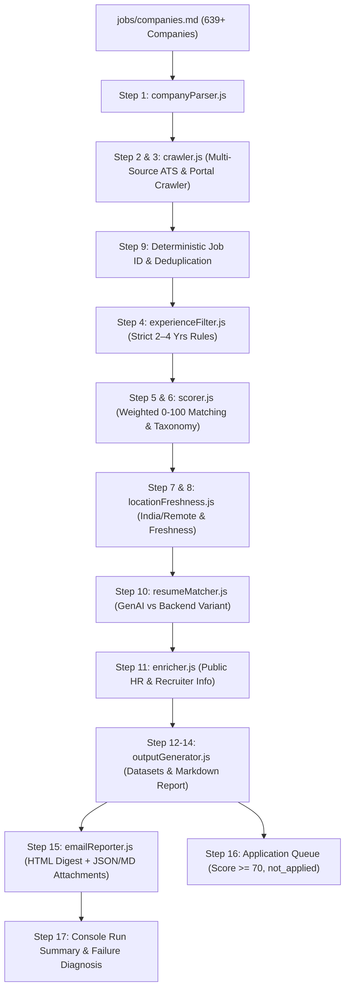

# AI Job Hunter — Node.js + Playwright

A combined job-discovery pipeline for Generative AI / LLM / Backend / Platform roles.

## Pipeline

1. Crawl an explicit allowlist of company career portals with Playwright.
2. Keep openings from the last 48 hours when a reliable posted date exists.
3. Score against AI, backend, data, cloud and product-engineering keywords.
4. Generate a stable job ID from company + title + URL.
5. Store complete job content and metadata in `data/jobs.json`.
6. Enrich only publicly exposed contact information from the job/company page.
7. Email a digest containing company, role, score, URL, HR email and public LinkedIn URL.
8. Keep application submission behind an explicit approval flag.

## Setup

```bash
npm install
cp .env.example .env
# Put your resume at the configured path
npx playwright install chromium
npm start
```

Add career portals to `config.js`:

```js
{ company: 'Company Name', url: 'https://company.example/careers' }
```

For serious use, add portal-specific adapters rather than relying on generic selectors. Each adapter should normalize to:

```js
{
  jobId, company, title, location, url, postedAt,
  description, skills, source, discoveredAt,
  matchScore, matched, hrEmails, linkedinContact,
  resumeName, resumePath, approved, applied
}
```

## Important

- Respect each site's robots.txt, terms, rate limits and access controls.
- Do not bypass CAPTCHA, authentication, anti-bot controls or private LinkedIn data.
- LinkedIn is best handled as a user-approved handoff rather than automated scraping/messaging.
- Keep `AUTO_APPLY=false` until each portal's automation policy and workflow are verified.


---

### Step-by-Step Execution Rules

| Condition | Action Taken |
| :--- | :--- |
| **7 Days Away** | • Creates `/interviews/[company]/[role]/`<br>• Creates notebook `[company] — [role] Interview.md`<br>• Conducts 12-month deep company & role research<br>• Runs candidate matching<br>• Generates all **11 artifacts** under `artifacts/`<br>• Sends structured email briefing |
| **1 Day Away (Tomorrow)** | • Generates `/interviews/[company]/[role]/final-revision.md` with top 10 technical Q&As, 5 system design scenarios, 5 STAR stories, 10 revision topics, and 5 interviewer questions<br>• Sends notification email |
| **> 1 Day Away** | • Checks for new developments since last run<br>• Updates master notebook only if new info is discovered<br>• Skips noisy emails if no new changes |

---

### Artifacts Generated (Under `/interviews/[company]/[role]/artifacts/`)

1. `01-company-briefing.md` — 12-Month Deep Company Research & Tech Radar
2. `02-jd-analysis.md` — JD Competencies & Capability Evaluation
3. `03-candidate-experience-mapping.md` — Verified Candidate Mapping & STAR Matrix
4. `04-technical-quiz.md` — General Technical Quiz
5. `05-backend-quiz.md` — Backend Engineering & Distributed Systems Quiz
6. `06-genai-llm-quiz.md` — Generative AI, LLM & RAG Systems Quiz
7. `07-system-design-questions.md` — System Design Scenarios
8. `08-behavioral-questions.md` — Behavioral & Leadership Questions (STAR Method)
9. `09-glassdoor-interview-faq.md` — Glassdoor & Publicly Reported FAQ
10. `10-rapid-revision-sheet.md` — 15-Minute Rapid Revision Cheat Sheet
11. `11-questions-to-ask-the-interviewer.md` — Strategic Questions to Ask the Panel

---

### Manual Execution & Scripts

You can also run the pipeline manually at any time using:

```bash
# Run daily interview prep check on upcoming.md
npm run interview-prep

# Force full workspace and artifact regeneration
npm run interview-prep:force
```

---

## 🚀 Automated Cold Outreach & Referral Engine

Reads recipient contacts from an Excel spreadsheet (`list.xlsx`), parses candidate profiles, and dispatches personalized cold outreach emails with anti-spam jitter delays, attachment handling, and deduplication tracking.

### Features
- **Excel / CSV Support:** Reads `./list.xlsx` with automatic sheet detection or custom `--sheet-name`.
- **Flexible Column Mapping:** Automatically detects `Name`, `Company`, `Email`, `Role`, `Link`, etc.
- **Anti-Spam Throttling:** Randomized jittered delays (20–35s) to protect SMTP reputation.
- **Deduplication:** Automatically logs sent messages to `data/outreach-sent.json` to prevent duplicate emails.
- **Dry-Run Mode:** Preview rendered subjects, HTML, and recipient lists before live sending.
- **PDF Resume Attachment:** Automatically attaches the configured `Yash_Giradkar_Resume.pdf`.

### Usage Commands

```bash
# Preview emails without sending (Dry Run)
npm run outreach:dry-run

# Dispatch live emails with default sheet (./list.xlsx)
npm run outreach

# Specify custom sheet name or limit
node src/outreach/index.js --sheet-name Bytedance --limit 10

# Custom delay (in seconds) between emails
node src/outreach/index.js --delay 30
```

---

## 🎯 17-Step Autonomous Job Intelligence & Discovery Pipeline

Scans authoritative company portals from `/jobs/companies.md`, crawls live job openings, applies 2–4 years experience filters, scores candidate match with weighted algorithms (Generative AI + LLM + Backend), enriches public recruiter metadata, generates intelligence datasets and Markdown reports in `/jobs/output/`, and delivers daily email digests.

### Pipeline Commands

```bash
# Run full scan across authoritative companies
npm run jobs:scan

# Run batch scan on top 20 companies with email digest
npm run jobs:scan:batch

# Dry run on top 10 companies without sending email
npm run jobs:scan:dry-run

# Custom options:
node src/jobs/index.js --limit 30 --companies-file jobs/companies.md
```

### Generated Output Files (`/jobs/output/`)
- `all-jobs.json` — All discovered openings
- `matched-jobs.json` — Openings matching candidate profile
- `recent-jobs.json` — Openings posted within last 48 hours
- `application-queue.json` — High-priority queue (Score ≥ 70) awaiting human approval
- `rejected-jobs.json` — Filtered openings with explicit rejection reasons
- `job-report.md` — Master Markdown intelligence report with breakdowns and tables


### Step-by-Step Architecture & Module Mapping



---

### Implementation Details Across All 17 Steps

| Step                         | Implementation & Behavior                                                                                                                               | File                   |
| :--------------------------- | :------------------------------------------------------------------------------------------------------------------------------------------------------ | :--------------------- |
| **1. Parse Company File**    | Reads `jobs/companies.md`, extracts `{ company, salaryRange, remotePolicy, careerUrl }` without skipping any rows.                                      | `companyParser.js`     |
| **2 & 3. Portal Crawler**    | Crawls portals (Greenhouse API, Lever API, Ashby, HTML job boards) capturing complete JD, title, location, salary, responsibilities, skills.            | `crawler.js`           |
| **4. Experience Filter**     | Evaluates explicit and inferred requirements against **2–4 years**: `1–3`, `2–4`, `2–5`, `1–5`, `2+` accepted; `5+`, `6+`, `8+`, Senior/Staff rejected. | `experienceFilter.js`  |
| **5. Role Matching**         | Weighted scoring: Role relevance (25%), Skill match (30%), AI/LLM relevance (20%), Backend relevance (10%), Experience (10%), Location (5%).            | `scorer.js`            |
| **6. Role Categorization**   | Classifies into: `Generative AI`, `LLM Engineer`, `AI Engineer`, `Applied AI`, `Machine Learning`, `Backend`, `Distributed Systems`, etc.               | `scorer.js`            |
| **7. Location Filter**       | Categorizes into: `India`, `Remote India`, `Bengaluru`, `Pune`, `Mumbai`, `Hyderabad`, `Delhi NCR`, `Chennai`, `International`.                         | `locationFreshness.js` |
| **8. Freshness**             | Categorizes into `0–1 days`, `2–3 days`, `4–7 days`, `8–14 days`, `15–30 days`, `30+ days`, `Unknown`. Highlights `<= 48 hours`.                        | `locationFreshness.js` |
| **9. Deduplication**         | Generates deterministic ID (`company-officialId` or `company-hash(title, location)`).                                                                   | `crawler.js`           |
| **10. Resume Matching**      | Maps to `Generative_AI_LLM_Engineer`, `Backend_Engineer`, `Full_Stack_Engineer`, or `Needs_Resume_Variant` with filesystem verification.                | `resumeMatcher.js`     |
| **11. Contact Enrichment**   | Extracts public recruiting emails and LinkedIn company handles without scraping private data or bypassing auth.                                         | `enricher.js`          |
| **12. Intelligence Record**  | Formats complete record with scores, skills, contact, categories, and `applicationStatus: "not_applied"`.                                               | `index.js`             |
| **13. Output Datasets**      | Generates `all-jobs.json`, `matched-jobs.json`, `recent-jobs.json`, `application-queue.json`, and `rejected-jobs.json`.                                 | `outputGenerator.js`   |
| **14. Markdown Report**      | Generates `jobs/output/job-report.md` with master tables and categorized sections.                                                                      | `outputGenerator.js`   |
| **15. Email Digest**         | Sends HTML digest containing summary stats, top matches, and attaches all 4 JSON/MD report files.                                                       | `emailReporter.js`     |
| **16. Application Workflow** | Queues jobs with `overallMatchScore >= 70` and marks `applicationStatus: "not_applied"` requiring human review.                                         | `index.js`             |
| **17. Run Summary**          | Emits console report with stats, high-match counts, and portal failure diagnosis + retry recommendations.                                               | `index.js`             |
